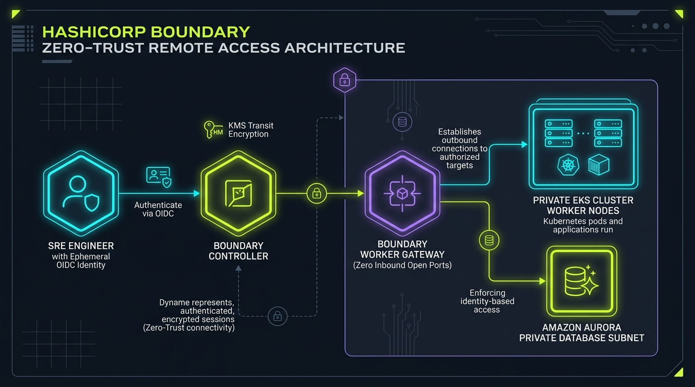

# HashiCorp Boundary Zero-Trust Access Studio

[](https://github.com/Pradeeptalari14/tp-boundary-zerotrust/actions)
[](LICENSE)
[](https://talaripradeep.info/tools/hashicorp-boundary-zerotrust/)
[](https://talaripradeep.info/studios/flow/?studio=hashicorp-boundary-zerotrust)

> **Author:** [Talari Pradeep](https://talaripradeep.info) — Senior SRE & Platform Architect  
> **Interactive Studio Workspace:** [https://talaripradeep.info/tools/hashicorp-boundary-zerotrust/](https://talaripradeep.info/tools/hashicorp-boundary-zerotrust/)  
> **Visual Flow Canvas DAG:** [https://talaripradeep.info/studios/flow/?studio=hashicorp-boundary-zerotrust](https://talaripradeep.info/studios/flow/?studio=hashicorp-boundary-zerotrust)  
> **Documentation Guide:** [https://talaripradeep.info/tools/hashicorp-boundary-zerotrust/learn.html](https://talaripradeep.info/tools/hashicorp-boundary-zerotrust/learn.html)

---

## 1. System Architecture Flow



### Architectural Highlights
Deploy identity-based zero-trust remote access for EKS clusters and Aurora databases without SSH keys, open bastion ports, or legacy static VPN credentials.

* **Cryptographic Provenance:** Guarantees tamper-proof software supply chain attestation before deployment.
* **Deterministic Policy Gates:** Continuous enforcement against unauthorized container digests, bad dependencies, or untrusted inputs.
* **Zero Static Secrets:** Ephemeral identity validation avoiding long-lived bastion credentials.

---

## 2. Infrastructure & Software Technology Stack

| Category | Technology | Architectural Role |
| :--- | :--- | :--- |
| **Zero-Trust Controller** | `HashiCorp Boundary 0.17+`, `AWS KMS Transit Encryption`, `PostgreSQL 16 HA Backend` | Enterprise verification & telemetry |
| **Private Worker Mesh** | `Multi-Hop Reverse Workers`, `Zero Public Inbound Ports`, `Mutual TLS Tunneling` | Enterprise verification & telemetry |
| **Target Workloads** | `Amazon Aurora PostgreSQL`, `AWS EKS Private Endpoints`, `Session Recording & Audit` | Enterprise verification & telemetry |

---

## 3. Primary Specification Manifest: `boundary-controller.hcl`

```yaml
disable_mlock = true

controller {
  name = "boundary-zero-trust-controller"
  database {
    url = "env://BOUNDARY_PG_URL"
  }
}

listener "tcp" {
  address = "0.0.0.0:9200"
  purpose = "api"
  tls_disable = false
  tls_cert_file = "/etc/boundary/cert.pem"
  tls_key_file = "/etc/boundary/key.pem"
}
```

---

## 4. Quickstart & Local Verification

### A. Clone and Validate
```bash
git clone https://github.com/Pradeeptalari14/tp-boundary-zerotrust.git
cd tp-boundary-zerotrust

# Execute SRE validation drill
chmod +x scripts/validate.sh
./scripts/validate.sh
```

### B. Run Implementation Automation
```bash
python3 main.py
```

---

## 5. Kubernetes & Docker Deployment

### Docker Run
```bash
docker build -t tp-boundary-zerotrust:latest .
docker run --rm tp-boundary-zerotrust:latest
```

### Kubernetes Admission Policy
```yaml
apiVersion: apps/v1
kind: Deployment
metadata:
  name: boundary-worker
spec:
  replicas: 2
  template:
    spec:
      containers:
        - name: worker
          image: hashicorp/boundary:latest
          args: ["server", "-config=/etc/boundary/worker.hcl"]
          volumeMounts:
            - name: config
              mountPath: /etc/boundary
```

---

## 6. SRE Runbook & Operational Verification

* **Verify Signatures & Telemetry:**
  ```bash
  cosign verify --certificate-identity-regexp '.*@github\.com' ghcr.io/pradeep/service:latest
  ```
* **Audit Rekor Transparency Log:**
  ```bash
  rekor-cli search --sha <IMAGE_SHA256_HASH>
  ```

---

## 7. License

Licensed under the [MIT License](LICENSE). Copyright (c) 2026 Talari Pradeep.
